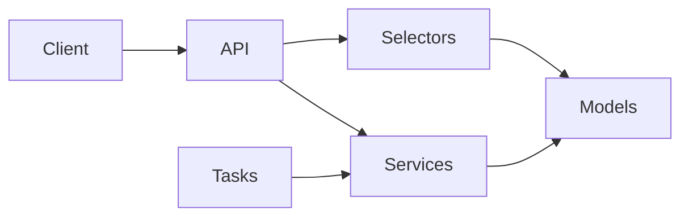

# Architecture Overview

High-level shape of Django Template as a reusable Django template.

## Stack

- **Django** — web framework and ORM
- **DRF** — REST APIs under `/api/v1/`
- **SimpleJWT** — bearer access/refresh tokens
- **PostgreSQL** — primary database
- **Celery** — async tasks (queue name `django_template`)
- **Redis** — cache (and Channels layer when used)
- **MinIO / django-storages** — optional object storage (probed by health when configured)

This template is **single-tenant** and **REST-first**. There is no GraphQL, gRPC, or FHIR layer in the current codebase.

## Application layout

```text
core/
  api/             # Envelope, pagination, permissions, URL mount
  common/          # BaseModel, shared utils, management commands
  users/           # User + password history, user APIs
  authentication/  # JWT + /me + password change/reset confirm
  systems/         # Health check selectors/API (mounted at /health/)
config/
  django/          # Django settings (base, local, production, test)
  settings/        # Celery, JWT, CORS, logging, etc.
```

## Layers (HackSoft)

Business logic lives in **services** (writes) and **selectors** (reads). APIs stay thin: validate → call service/selector → serialize.

See [Django Styleguide](../standards/django-styleguide.md) and `.cursor/rules/django-styleguide.mdc`.



## Auth and authorization

- Authentication: JWT via `core.authentication` (obtain / refresh / verify / blacklist).
- `must_change_password` blocks most authenticated APIs until cleared (password change or reset confirm).
- Policy hooks exist (`AuthorizedAPIView`, `PolicyPermission`) but currently gate on **staff/superuser** until a real security app is added.

## Health

`GET /health/` (not under `/api/v1/`) probes database, cache, RabbitMQ, and MinIO when used. Deploy scripts use this path.

## Related

- [REST API Overview](../api/rest/overview.md)
- [ADR template](adr/0001-template.md)
